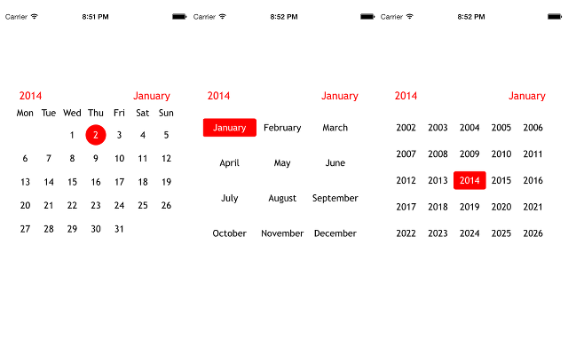
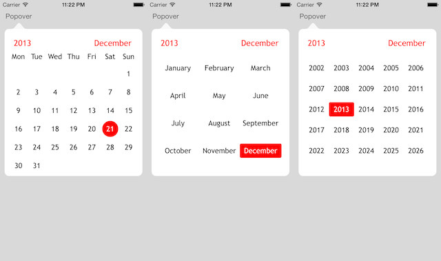
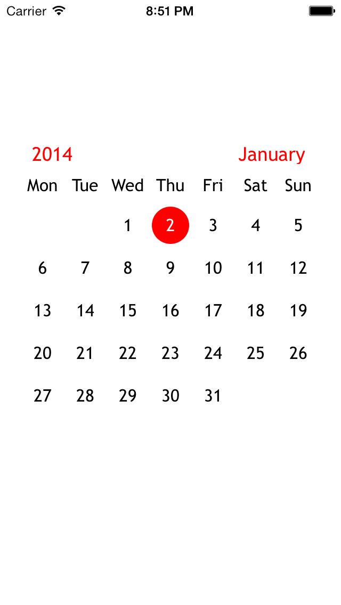
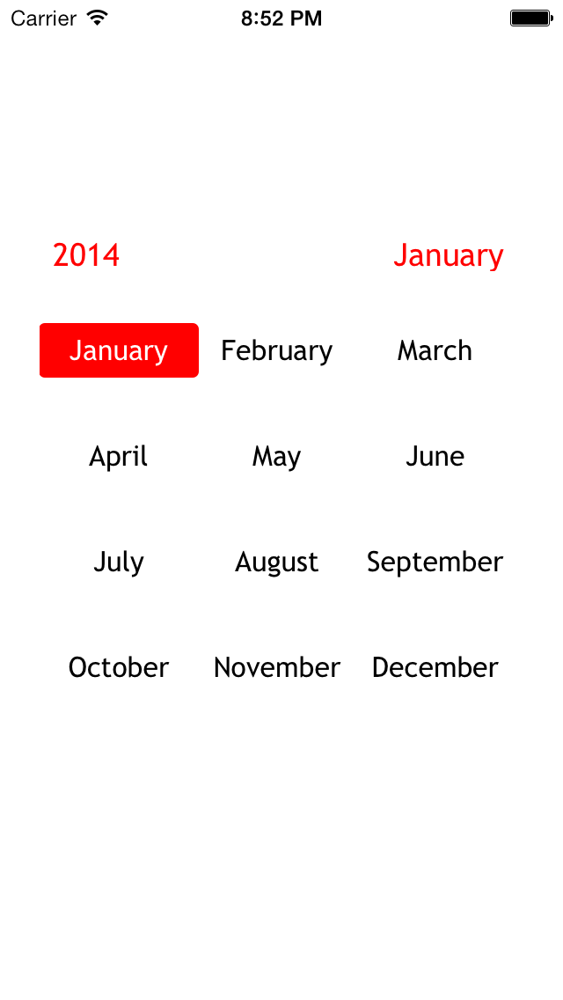
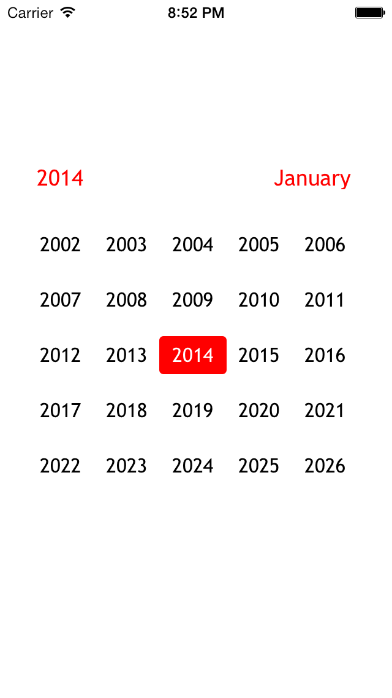
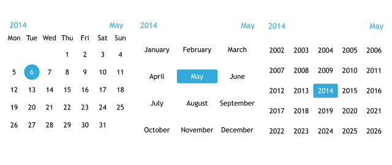

# iOS Calendar

[](https://cocoapods.org/pods/Calendar-iOS)
[](https://cocoapods.org/pods/Calendar-iOS)
[](https://cocoapods.org/pods/Calendar-iOS)

A lightweight and simple calendar control with support for `Locale` and `CalendarIdentifier`. There are samples for iPhone and iPad, and also for using a popover.



Using a popover:



## How to install

**CocoaPods:**

```ruby
pod 'Calendar-iOS'
```

**Manual:**

Add the following source files to your project:

```
CalendarView.h
CalendarView.m
NSDate+CalendarView.h
NSDate+CalendarView.m
NSString+CalendarView.h
NSString+CalendarView.m
```

## How to use

You can add the view in Interface Builder and set its class to `CalendarView`, or create it in code:

```objc
CalendarView *calendarView = [[CalendarView alloc] initWithPosition:10.0 y:10.0];
[self.view addSubview:calendarView];
```

That's it, you should see the calendar view.

This component was created for iPhone/iPod resolution. It works on iPad, but it looks really small; if necessary, you can play with the static constants in `CalendarView.m`. Scaling may be added in the future.

### Modes

The calendar has several modes:

```objc
typedef NS_ENUM(NSInteger, CalendarMode)
{
    CalendarModeDefault,
    CalendarModeMonthsAndYears,
    CalendarModeYears
};
```

- **Default** — days, months and years. The user can change months with a swipe gesture or a pinch gesture for transitions in the calendar.
- **MonthsAndYears** — months and years only.
- **Years** — years only.

<table>
  <tr>
    <td></td>
    <td></td>
    <td></td>
  </tr>
  <tr>
    <td align="center">Default</td>
    <td align="center">MonthsAndYears</td>
    <td align="center">Years</td>
  </tr>
</table>

There are external methods to mimic the swiping behavior in case a different UI is desired. However, these events will be logged with a different event type than swiping.

### Display options

There are also some options for display:

```objc
// Whether the currently selected date should be marked
@property (nonatomic, assign) BOOL shouldMarkSelectedDate;
// Whether today's date should be marked
@property (nonatomic, assign) BOOL shouldMarkToday;
// Whether the month and year headers should be shown
@property (nonatomic, assign) BOOL shouldShowHeaders;
// Preferred weekday start
- (void)setPreferredWeekStartIndex:(NSInteger)index;
```

- **Date Markers** — default behavior is to mark the currently selected date and not today, but this can be customized to suit your needs. If both are marked and coincide on the same day, it will show up with the current selection color, not today's color.
- **Headers** — default behavior is to show the headers, but they can also be hidden, in which case everything else will get shifted up accordingly (after a `setNeedsDisplay` call).
- **Preferred Week Start** — default behavior is Monday. Determines which day of the week is in the leftmost column.

## How to use Locale and CalendarIdentifier

It's very simple and useful to create a calendar based on your locale and, of course, your country.

```objc
NSLocale *persianLocale = [[NSLocale alloc] initWithLocaleIdentifier:@"fa-IR"];
[self.calendarView setLocale:persianLocale];
```

And to use a `CalendarIdentifier`, use this property:

```objc
[self.calendarView setCalendarIdentifier:NSCalendarIdentifierPersian];
```

If you set the `useVeryShortWeekdaySymbols` property to `YES`, the days of the week will use very short names:

```objc
self.calendarView.useVeryShortWeekdaySymbols = YES;
```


## How to select a range of dates

<table>
  <tr>
    <td></td>
    <td></td>
  </tr>
</table>

Long-press an item to select a date, and long-press the end date to select the end of the range. To get the selected range, use the `didSelectRangeForStartDate:andEndDate:` delegate method like this:

```objc
- (void)didSelectRangeForStartDate:(NSDate *)startDate andEndDate:(NSDate *)endDate {
    NSLog(@"%s: start date :%@ \n end date : %@", __PRETTY_FUNCTION__, startDate, endDate);
}
```

## How to handle the changing date event

For this you should use the `CalendarViewDelegate` protocol:

```objc
@interface ViewController : UIViewController <CalendarViewDelegate>

@end
```

And set up the delegate:

```objc
self.calendarView.calendarDelegate = self;
```

After that you should implement the required `didChangeCalendarDate` method:

```objc
- (void)didChangeCalendarDate:(NSDate *)date
{
    NSLog(@"didChangeCalendarDate:%@", date);
}
```

For more details there are optional methods for other things:

```objc
@optional
- (void)didChangeCalendarDate:(NSDate *)date withType:(NSInteger)type withEvent:(NSInteger)event;
- (void)didDoubleTapCalendar:(NSDate *)date withType:(NSInteger)type;
```

## How to customize colors

For customization of colors you can use the following properties:

```objc
// Main color of numbers
@property (nonatomic, strong) UIColor *fontColor;
// Color of the headers (year and month)
@property (nonatomic, strong) UIColor *fontHeaderColor;
// Color of selected numbers
@property (nonatomic, strong) UIColor *fontSelectedColor;
// Color of selection
@property (nonatomic, strong) UIColor *selectionColor;
// Color of today
@property (nonatomic, strong) UIColor *todayColor;
```

For example:

```objc
self.calendarView.selectionColor = [UIColor colorWithRed:0.203 green:0.666 blue:0.862 alpha:1.000];
self.calendarView.fontHeaderColor = [UIColor colorWithRed:0.203 green:0.666 blue:0.862 alpha:1.000];
```

And you can see the result:



It's free to use, feel free. And I hope it will be helpful.

## License

iOS Calendar is available under the MIT license. See the [LICENSE](LICENSE) file for more info.
